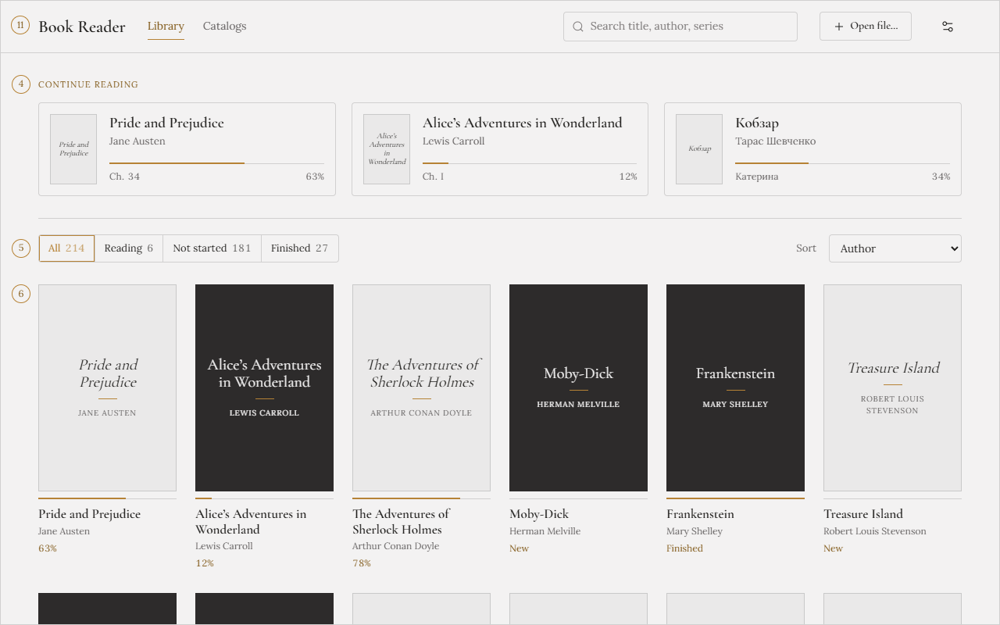
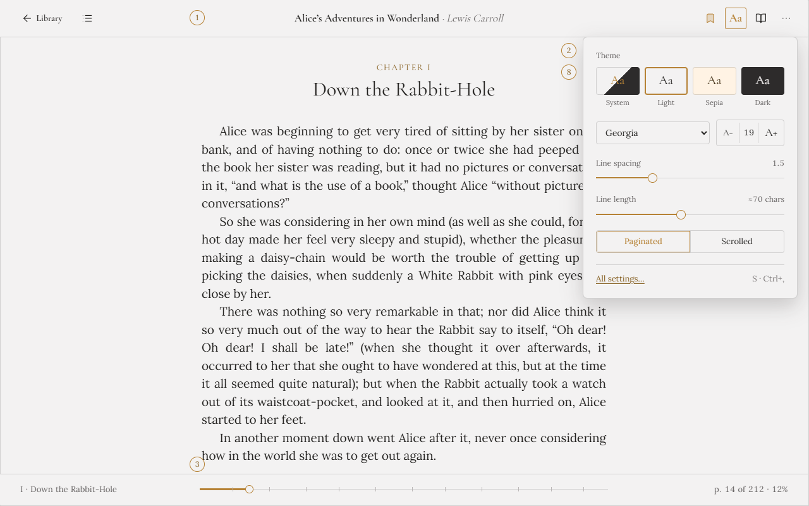
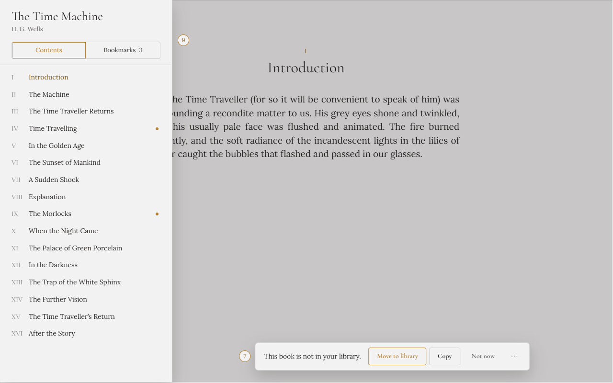
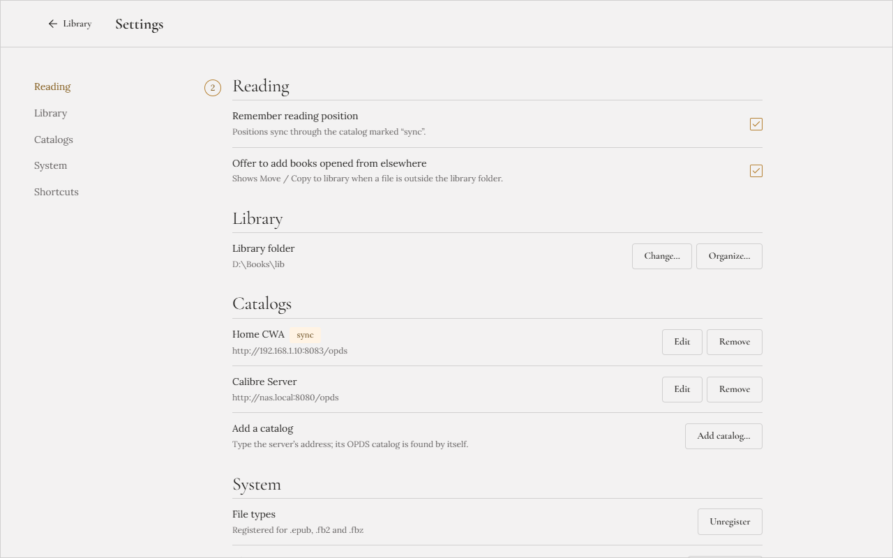
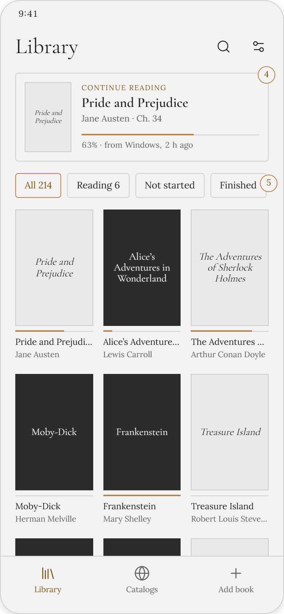
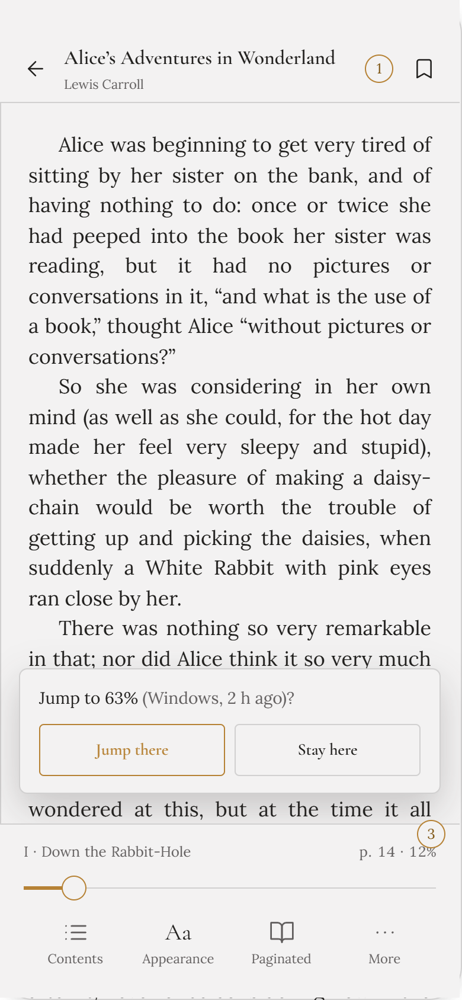
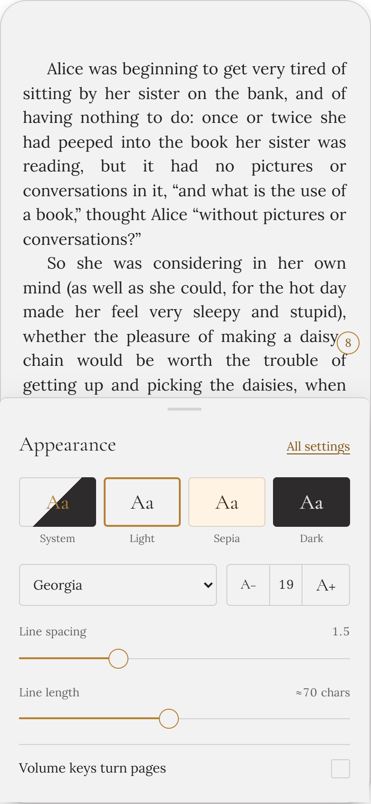
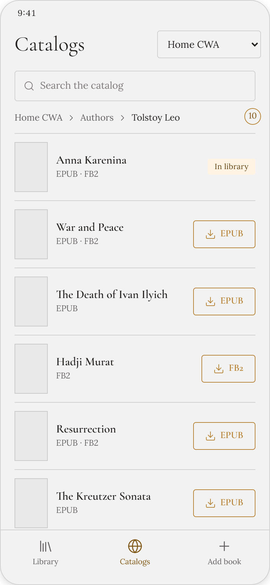

# Handoff: Book Reader UI refresh (Windows + Android)

The design for roadmap stage 6 (UI refresh). **Where this proposal and the spec disagree, the [decisions](#decisions) below win**; the spec (`docs/spec.md`) is updated as each part is built.

## Decisions

Settled when the proposal was taken into the roadmap (22.11.2026):

1. **Progress label (finding 3):** pages count within the chapter, as the spec has it ("the book-wide position stays the progress bar's %"): `p. 14 of 30 · 12%`, not `p. 14 of 212`. foliate-js doesn't know a book's page count without laying out every chapter. Chapter ticks on the track are fine (the TOC's sections and their fractions are known).
2. **Continue-reading cards (finding 4):** no synced device / time on the cards. That would ask the sync server for every recent book whenever the library opens; the sync offer stays where it is, on the open book (M2).
3. **Fonts (finding 11):** bundled as woff2 in `src/fonts/` with their OFL licence, never loaded from Google Fonts (`reference/classical.css` imports them from there only for the design tool). Two families × two weights; keep only the subsets the UI needs (Latin, Cyrillic) to stay small.
4. **Shortcuts:** `S` and `Ctrl+,` open the Aa popover while reading and the Settings page in the library, so neither loses a meaning it has now.
5. **Contents numbering (D3):** Roman numerals only when the book's TOC labels carry them; no numbering is invented.
6. **The HTML reference** (`reference/BookReader UI.dc.html`) opens only in the design tool: it loads `support.js` and a `_ds/` bundle that aren't in the repo. The screenshots and this file are the reference.

## Overview
A review of the current UI (`index.html`, `src/style.css`, `src/settings-panel.ts`, `src/sources-panel.ts`, `src/catalog-view.ts`) and a proposal for both platforms. **The feature set does not change** — only grouping, hierarchy, typography and touch ergonomics. UI copy stays English (spec: "UI language — English only").

## About the design files
`BookReader UI.dc.html` is a **design reference made in HTML**, not production code. Recreate it in the existing stack: plain TypeScript + `el()` from `src/dom.ts`, styles in `src/style.css`, no framework. `classical.css` is the token sheet the reference uses; copy the values you need into `:root` of `src/style.css`.

## Fidelity
High-fidelity for layout, hierarchy and tokens. Covers are typographic placeholders (the app already draws a title box when a book has no cover). Book text is set in the reader's font in the real app (default Georgia), not Lora.

## Findings → changes
| # | Now | Change | Where |
|---|---|---|---|
| 1 | Topbar: up to 8 equal text buttons; wraps to 2 rows (76 px) on touch | Left: ← Library, Contents. Centre: title · author. Right: Bookmark, **Aa**, mode, **⋯** (Shortcuts, About, Full screen). Android: top = back/title/bookmark; bottom bar = progress + Contents / Aa / Mode / More | `index.html #topbar`, `style.css @media (pointer: coarse)` |
| 2 | One settings panel mixes appearance with library, file types, history, catalogs | **Aa popover** (reader): theme, font, size, line spacing, line length, Paginated/Scrolled, "All settings…". **Settings page** (library mode): Reading / Library / Catalogs / System / Shortcuts | split `createSettingsPanel` into `createAppearancePanel` + `createAppSettings`; `sources-panel.ts` moves into the page |
| 3 | 3 px progress bar, label on hover only | Always-visible row while chrome is shown: chapter · track with chapter ticks + knob · `p. 14 of 212 · 12%`. Android: slider, 21 px knob | `#progress`, `main.ts` progress handler |
| 4 | "Continue reading" = text list, % on the right | Cards (3 on desktop, 1 on phone): cover 60 px, title, author, hairline progress, chapter, %; synced position shows device + time | `#recent` |
| 5 | Status and sort are two `<select>`s next to search | Status → segmented control with counts (All / Reading / Not started / Finished); sort stays a compact select on the right. Android: horizontal chips | `.library-bar`, `#library-status` |
| 6 | Grid has no reading state | 2 px progress line under each cover + status line: `New` / `NN%` / `Finished` (≥98%, as in spec) | `#library-books` |
| 7 | Offer bar: 5 equal buttons | Primary = last choice (Move or Copy), secondary = the other, "Not now", **⋯** → "Never for this file" | `#offer` |
| 8 | Theme = 4 text buttons | 4 page swatches "Aa" drawn in each theme's colours; selected = 2 px accent ring. System = split light/dark swatch | `settings-panel.ts themeButtons` |
| 9 | Bookmarks under the TOC, max 40 % height | Segmented **Contents / Bookmarks (n)** at the top of the drawer; current chapter in accent text; chapters with bookmarks marked with a dot | `#toc`, `#bookmarks` |
| 10 | Catalog: separate "← Back", "in library" hidden in grey meta | Breadcrumb of the OPDS path (Android Back still pops one level); `In library` tag; outlined download button with format + icon | `catalog-view.ts render / bookRow` |
| 11 | Segoe UI 14 px, grey accent `#6b6b6b`, blue links | Headings Cormorant Garamond, UI text Lora, single gold accent used as strokes, not fills | `style.css :root` |

Android Library/Catalogs tabs become a bottom navigation: Library · Catalogs · Add book (44 px+ targets, safe-area padding kept).

Later (issue #122, 11.2026) the library's navigation became one tree on both platforms: **Library** folding out to Continue reading · Books · Series · Removed, then Catalogs, then **Settings** folding out to its sections. On the desktop it is the pane; on the phone the same pane is a drawer from the left (☰ or a swipe to the right), and the bottom navigation is gone.

The library bar (issues #126, #127): the status chips, which scrolled sideways on the phone, became one button with the chosen status and its count, opening a menu of all four with their counts; the sort `<select>` became an icon button with its own menu; a covers / list button switches Books and a series' books to a compact list.

## Screens
**D1 Library (1280×800).** Header row: padding 14/48 px, hairline bottom; brand (Cormorant 22/600), tabs (14 px; active = accent text + 1 px accent underline), search 300 px, "Open file…" (outlined), settings icon button 36 px. Content padding 32/48 px, gaps 28 px. Grid: 6 columns, gap 28×24.
**D2 Reader + Aa.** Topbar padding 10/16. Text column 640 px centred, 19 px / 1.5, justified. Bottom row grid `260px 1fr 260px`, 13 px tabular figures. Popover 340 px, top 58 px, right 16 px, padding 20, gap 18, radius 7, shadow-lg.
**D3 Contents.** Drawer 360 px, scrim `neutral-900 @22%`. Rows 7/12 px padding, roman numeral column 36 px. Offer bar: bottom 24 px, radius 7, shadow-lg.
**D4 Settings.** Section nav 220 px + content (max 760 px). Rows: label 14 px + hint 12 px left, controls right, hairline between rows. Sync source gets an accent `sync` tag.
**M1–M4 (390×844).** Side padding 20 px, all hit targets ≥ 44 px. Bottom sheet (M3): top radius 7 px, grab handle 36×3, theme swatches 52 px high.

## Interactions
- Center tap (Android) / mouse near top edge (desktop) toggles chrome — top and bottom bars together.
- Aa popover: Esc or click outside closes; `S` / `Ctrl+,` opens it while reading; "All settings…" opens the Settings page.
- Contents drawer: `T`; segmented switch remembers last tab per session.
- Sync bar (M2) sits above the bottom bar: "Jump to 63% (Windows, 2 h ago)?" · Jump there (primary) · Stay here.
- Hover: `color-mix(text 7%)` on neutral buttons, `accent 12%` on outlined primary. Focus: `outline: 2px solid accent; offset 2px`.

## Design tokens (light)
- bg `#f3f2f2`, surface `#eae9e9`, text `#201f1d`, accent `#b68235`, divider `#201f1d @16%`; accent text on light = `--color-accent-700`.
- Sepia: bg `--color-accent-100`, text `--color-accent-900`. Dark: bg `--color-neutral-900`, text `--color-neutral-200`. (Ramps in `classical.css`.)
- Spacing 4.6 / 9.2 / 13.8 / 18.4 / 27.6 / 36.8 px; radius 2 / 4 / 7 px.
- Shadows: sm `0 1px 2px #2d2b2b24`, md `0 3px 10px #2d2b2b29`, lg `0 12px 32px #2d2b2b38`.
- Type: Cormorant Garamond 400/600 (headings), Lora 400/600 (UI). Figures tabular in counts, progress, page numbers. App is offline-first, so **bundle the fonts** (woff2 in `src/fonts/`) instead of Google Fonts.

## Assets
Icons: Lucide (arrow-left, list, bookmark, book-open, ellipsis, search, sliders-horizontal, plus, library, globe, download, chevron-right, check), inline SVG, stroke 1.5.

## Screenshots
Numbered circles match the findings table.

| | |
|---|---|
| D1 Library |  |
| D2 Reader + Aa |  |
| D3 Contents + offer |  |
| D4 Settings |  |

| M1 Library | M2 Reader | M3 Appearance | M4 Catalog |
|---|---|---|---|
|  |  |  |  |

## Files
- `screenshots/` — PNG of every screen (desktop 1×, Android 2×).
- `BookReader UI.dc.html` — the reference (open with the design tool; needs `classical.css`).
- `classical.css` — token sheet.
- This file is `docs/design/ui-refresh.md`; the reference files are in `docs/design/reference/`.
